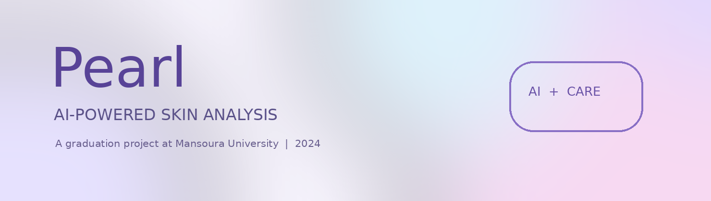
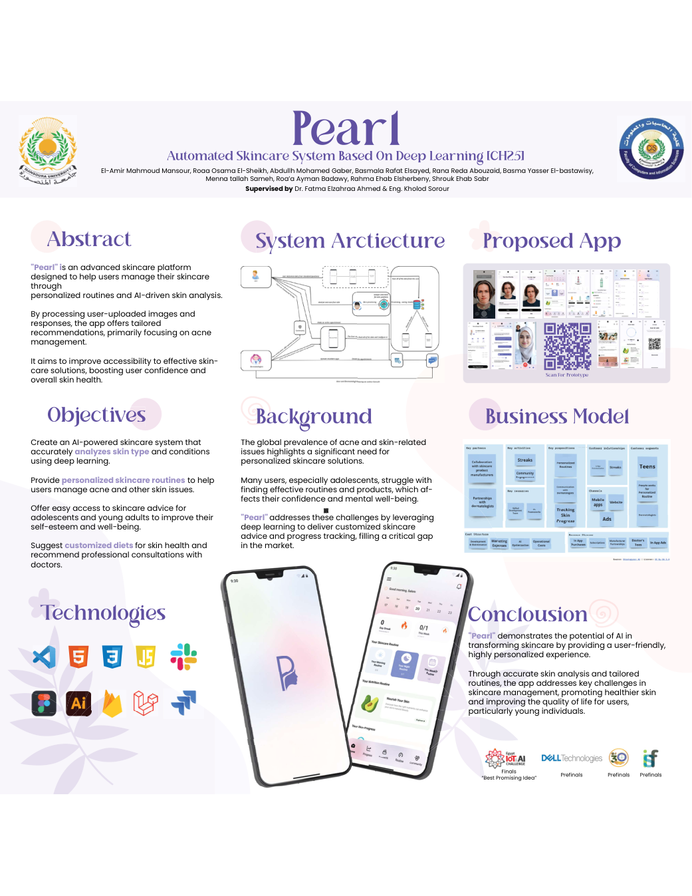
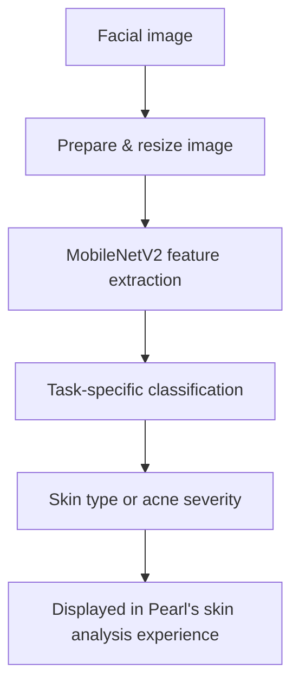

### A little bit of skincare, a lot of learning, and a whole team behind it 💜

**Mansoura University · Graduation Project · 2023–2024**

[The AI work](docs/deep-learning.md) · [Project poster](references/pearl-poster.pdf) · [Graduation report](references/graduation-documentation.pdf)

---

## 🌸 The story behind Pearl

**Pearl** started as our graduation project at Mansoura University. We wanted to make it easier for people—especially teenagers and young adults—to understand their skin and build a routine that feels more personal.

The idea was to combine a mobile skincare experience with **AI-based facial image analysis**. The AI component looks at two different questions: *What is this person's skin type?* and *How severe is the acne visible in the image?* The broader app design uses this information alongside users' answers to guide their skincare experience.

I worked on the **deep learning and AI models**. This repository is my way of sharing that work while celebrating the project we built together.

## ✨ Meet the project

 Our original graduation-project poster

### What we set out to build

| Feature | What it adds to Pearl |
|:--|:--|
| 🧴 Skin type analysis | Identifies dry, normal or oily skin from a facial image |
| 🔬 Acne severity analysis | Classifies clear, mild, moderate or severe acne |
| 🌷 Personal routines | Morning, evening and weekly skincare guidance |
| 📈 Progress tracking | A place to follow changes in skincare routines |
| 🛍️ Product information | A way to discover skincare products |
| 🥗 Nutrition guidance | Diet and hydration-related suggestions |
| 👩‍⚕️ Dermatologist features | Doctor discovery and appointment-related flows |

## 📱 A look inside Pearl

The app was designed around a simple idea: getting skincare guidance shouldn't feel complicated. These screens are taken from our **original project documentation**.

### A friendly first impression

### Your skincare space

### Where the AI steps in

The scan experience displays the model outputs for skin type and acne severity in a way that users can understand.

## 🧠 Behind the AI

This was my favorite technical challenge: turning facial images into useful classification outputs.

We worked on **two image classification tasks**, both documented as transfer-learning models built around an **ImageNet-pretrained MobileNetV2 backbone**.

| Model | Classes | Core approach |
|:--|:--|:--|
| **Skin type** | Dry / Normal / Oily | MobileNetV2 + custom classifier |
| **Acne severity** | Clear / Mild / Moderate / Severe | MobileNetV2 + custom classifier |

### How the image gets to a prediction

Our documentation describes resizing inputs to **244 × 244**, using Keras' `ImageDataGenerator`, and applying MobileNetV2 preprocessing. It also describes **CLAHE contrast enhancement** and connectivity analysis within the skin-type preprocessing work.

### From our model design notes

<table><tr>
<td width="50%"> Skin type workflow</td>
<td width="50%"> Acne severity workflow</td>
</tr></table>

Both models use a custom classification head with **global average pooling, dense layers, dropout and softmax**. The skin-type section documents an **Adam optimizer (learning rate 0.001)** and categorical cross-entropy; the acne-severity section describes **15 training epochs**, validation monitoring and `ReduceLROnPlateau`.

We reviewed model performance with measures such as **accuracy, precision, recall and F1-score**. You can read the detailed steps in [the AI walkthrough](docs/deep-learning.md).

## 👩‍💻 The part I worked on

**Deep Learning & AI Models**

My role was focused on the computer vision side of Pearl: working with the image datasets, preprocessing images, building and training the classifiers, and evaluating how the models performed. I especially enjoyed seeing how transfer learning could help tackle an applied image classification problem.

Pearl taught me that building an AI feature is about more than choosing a model. The preparation of the data, the classes, the evaluation, and the way results are presented all matter.

## 🛠️ Tools we used

**My AI focus:** Python · TensorFlow / Keras · MobileNetV2 · CNNs · Transfer Learning · Image Processing · CLAHE · Google Colab / Jupyter

**Broader team project:** Android / Kotlin · Laravel · HTML / CSS / JavaScript · Firebase · Figma

## 🏗️ The bigger picture

Pearl was a team effort spanning AI, app design, mobile development and backend work. The diagrams and interface designs in our report show how those pieces fit together.

## 🏆 A project worth remembering

Our poster records Pearl reaching the **finals** of a competition where it received the **“Best Promising Idea”** recognition. Presenting the project and seeing the team’s efforts come together was one of the highlights of our graduation year.

## 📚 More to explore

| File | Contents |
|:--|:--|
| [Deep learning walkthrough](docs/deep-learning.md) | Dataset preparation, model architecture, training and evaluation |
| [Product overview](docs/product-overview.md) | Key features, user experience and system context |
| [Full graduation report](references/graduation-documentation.pdf) | The original project documentation |
| [Official poster](references/pearl-poster.pdf) | The poster from our team |
| [Project presentation](references/project-presentation.pptx) | The original graduation presentation |

## 🤝 The people behind Pearl

This was a **team graduation project** completed in 2023–2024 at the Faculty of Computers and Information, Mansoura University.

**Team members:** ElAmir Mahmoud Mansour, Roaa Osama Abdelaliem El-Sheikh, Abdullh Mohamed Ahmed Gaber, Basmala Rafat Elsayed Ali, Rana Reda Sayed Abouzaid, Basma Yasser Mohamed El-Bastawisy, Menna Tallah Sameh Abdellateef, Roa’a Ayman Ahmed Badawy, Rahma Ehab Fayek Elsherbeny, and Shrouk Ehab Sabry Kandil.

**Supervised by:** Dr. Fatma El-Zahraa Ahmed & Eng. Kholoud Srour.

---

**Thanks for taking a look at Pearl! 💜**

