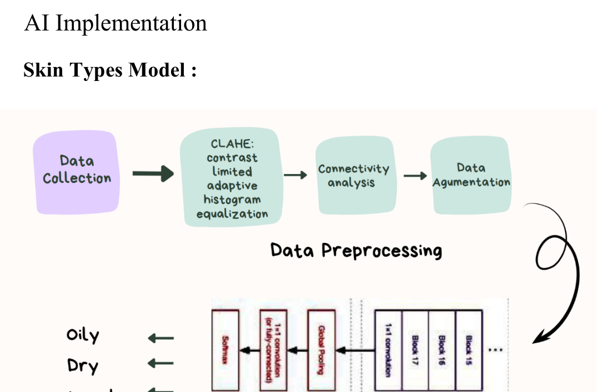
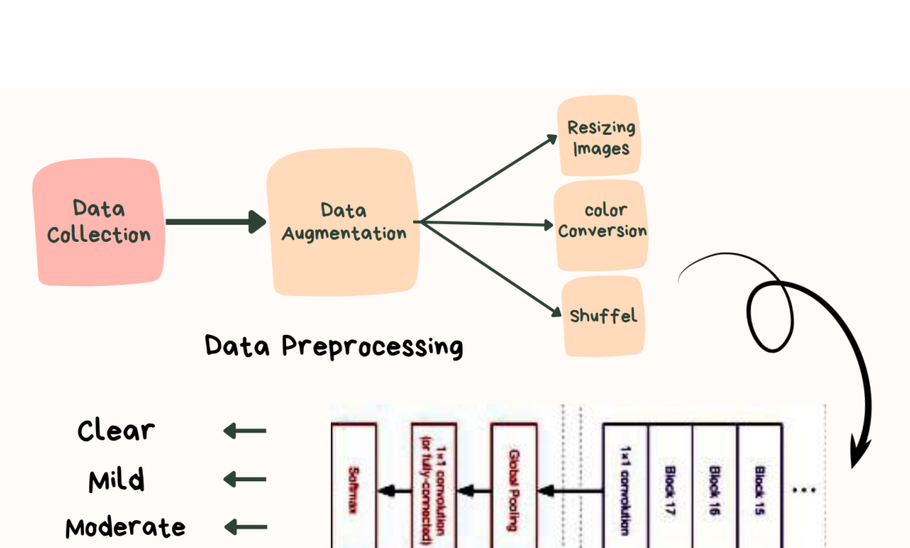

# 🧠 The Deep Learning Work Behind Pearl

I was responsible for the AI and deep-learning models in our graduation project. This page brings together the methods described in the original project documentation, mainly **Chapter 5, Section 5.1** (PDF pages 89–94).

## What were we predicting?

- **Skin type:** Dry, Normal, Oily.
- **Acne severity:** Clear, Mild, Moderate, Severe.

Both problems were framed as image classification tasks using **MobileNetV2 transfer learning**.

## Preparing the images

The original report describes image paths and labels stored in pandas DataFrames (`skin_df` and `Acne_df`), followed by training, validation and test sets. For the acne-severity model, the documented split was **70% training / 20% validation / 10% testing**.

Keras `ImageDataGenerator` handled image loading and preprocessing. Both model descriptions specify images resized to **244 × 244 pixels**, then passed through MobileNetV2-specific input preprocessing.

For the skin-type task, the report also discusses **CLAHE in LAB color space** for local contrast enhancement and connectivity analysis using **4-connectivity and 8-connectivity**. Those steps were included in a custom preprocessing workflow.

## Building the models

Both tasks used **ImageNet-pretrained MobileNetV2 without the original classification layer**. The new classifier head added **global average pooling, dense layers, dropout, and a softmax output** suitable for the number of classes.

## Training and evaluation

| | Skin type | Acne severity |
|:--|:--|:--|
| Classes | 3 | 4 |
| Backbone | MobileNetV2 | MobileNetV2 |
| Model head | GAP → Dense → Dropout → Softmax | GAP → Dense → Dropout → Softmax |
| Training detail in report | Adam (`lr=0.001`), categorical cross-entropy | 15 epochs |
| Learning rate strategy | ReduceLROnPlateau | ReduceLROnPlateau |
| Evaluation | Test loss, accuracy, precision, recall, F1 | Test loss, accuracy, precision, recall, F1 |
| Model filename documented | `model.keras` | `AcneClassification_MobileNetmodel.keras` |

The related-work accuracy table in Chapter 2 describes **other papers**, so none of those numbers should be confused with Pearl's results. This showcase sticks to the performance measures actually documented for our models rather than guessing an overall percentage.

## What I took away

Transfer learning made it possible to build task-specific skin-image classifiers on top of an existing image backbone. More importantly, this project gave me practical experience in data preparation, model development, debugging, evaluation and working across a larger application team.

**Source:** [Original graduation report](../references/graduation-documentation.pdf), Chapter 5 §5.1, PDF pp. 89–94.
