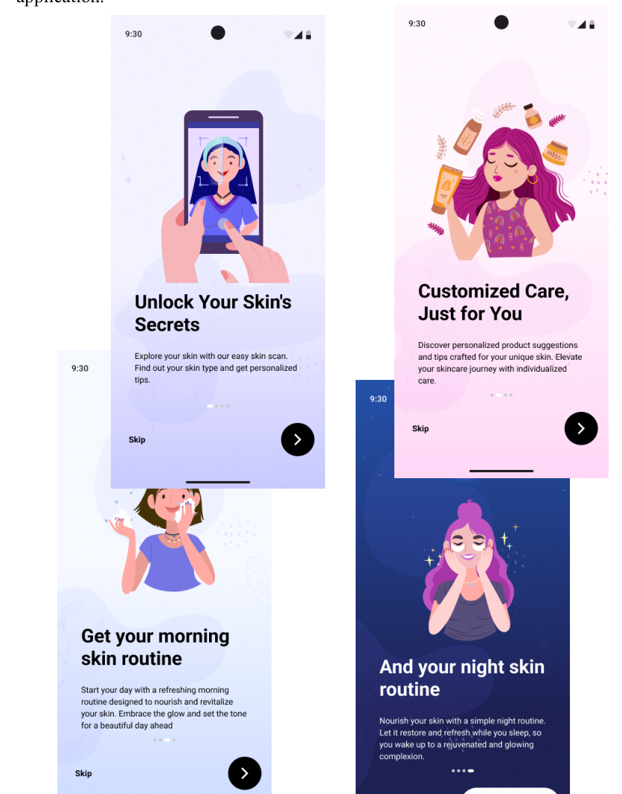
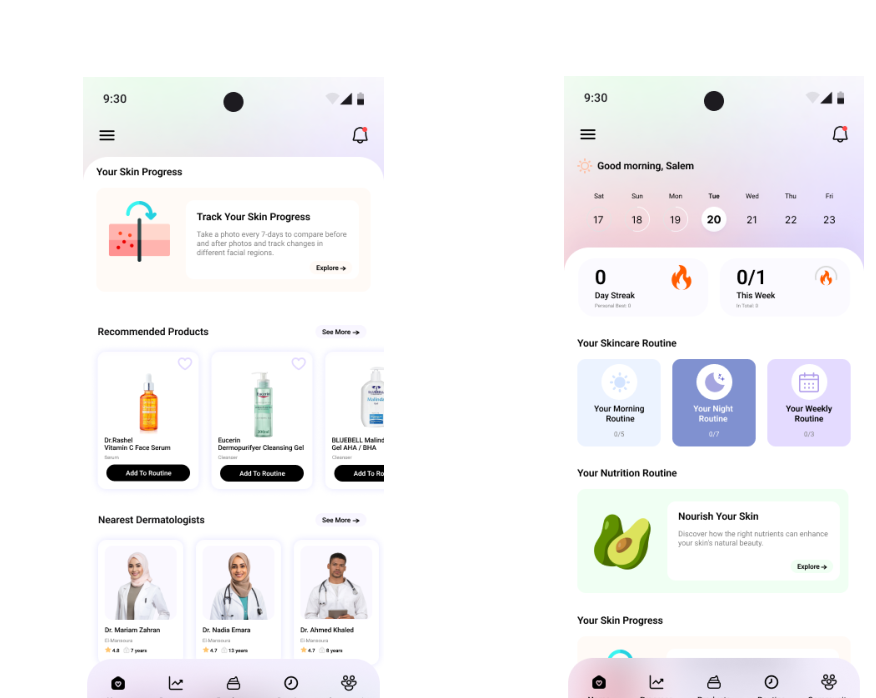
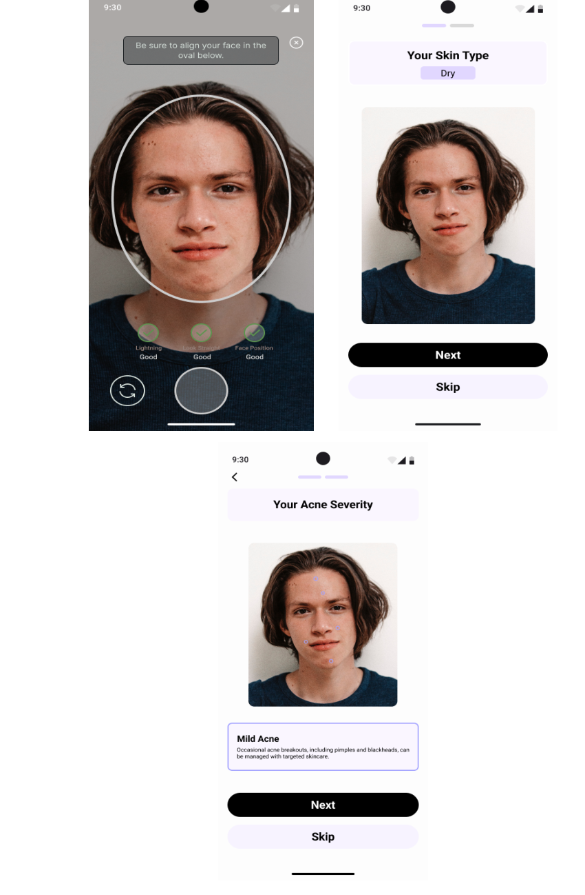
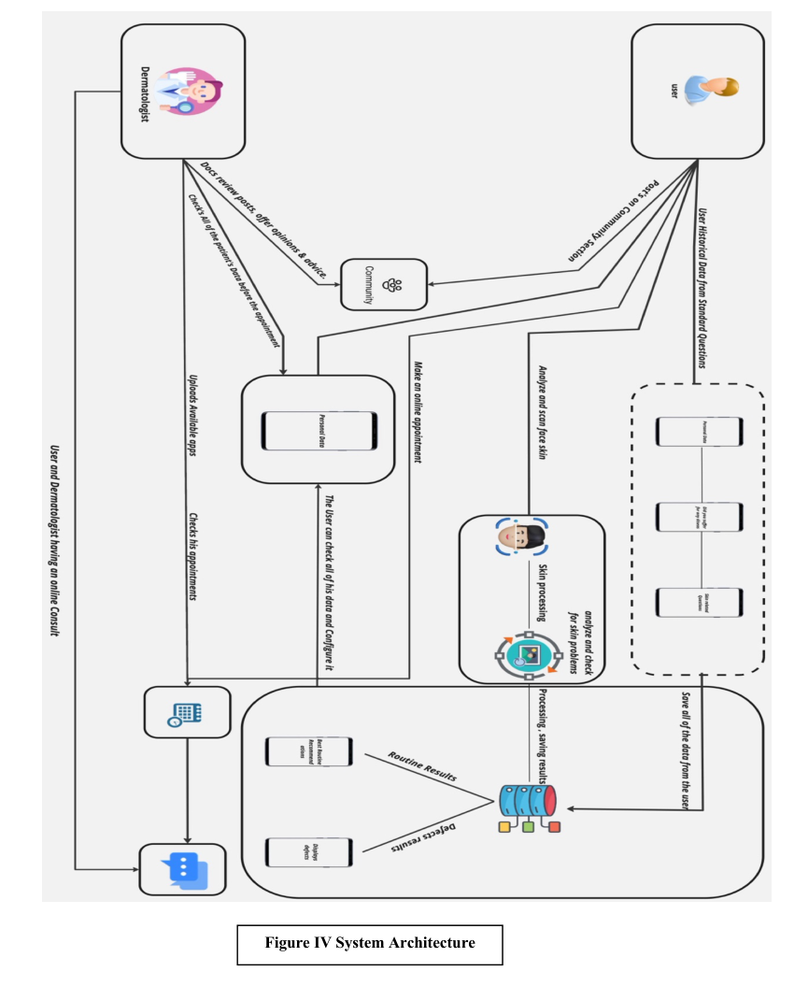

# 🌸 Pearl: Product Overview

Pearl is the graduation project our team developed at Mansoura University (2023–2024). Our goal was to explore how facial image analysis could support a more personalized skincare experience, with particular attention to skin type and acne severity.

## The experience we designed

- **Onboarding and accounts** to introduce the application.
- **Skin scan screens** that display skin type and acne-severity results.
- **Daily and weekly skincare routines** tailored to user information.
- **Product recommendations, progress tracking and nutrition guidance** within the app experience.
- **Dermatologist-related features** for consultations and appointments.

## Screens from the original documentation

### Onboarding

### Home

### Skin analysis

## Architecture

These visuals are **screens and diagrams from the original team documentation**, not screenshots of a currently hosted live service.

See the [graduation report](../references/graduation-documentation.pdf) for the complete system requirements and designs.
